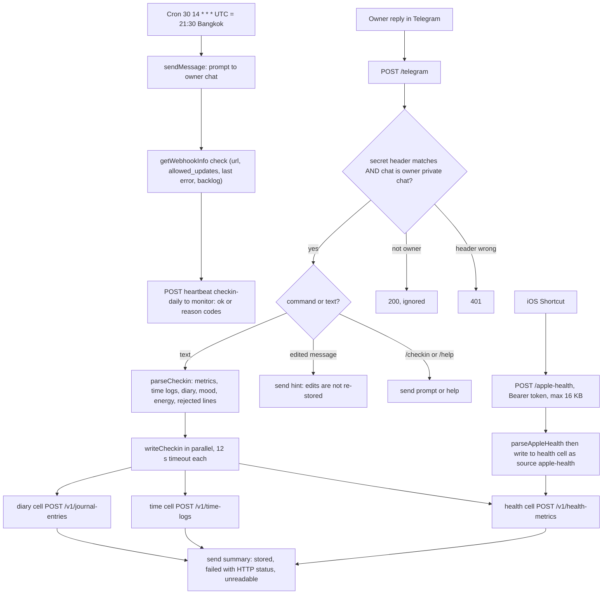
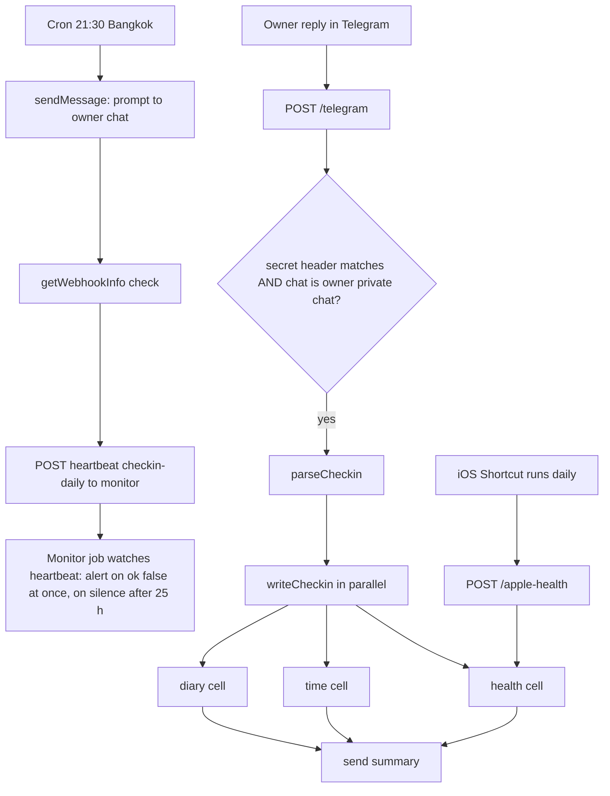

# 01 — Business process (As-Is / To-Be)

life-checkin-worker คือ Cloudflare Worker `solo-empire-checkin` ที่ส่งข้อความเช็กอินตอนเย็นทาง Telegram bot ถึง owner คนเดียว รับคำตอบทีละบรรทัด (หรือยอดรายวันจาก iOS Shortcut ของ Apple Health) แล้วเขียนลง cell สุขภาพ เวลา และไดอารี่ พร้อมรายงานผลกลับในแชทและส่ง heartbeat รายวันให้ uptime monitor

Last reviewed: 2026-11-27 · commit `810a29c`

## As-Is (จากโค้ดวันนี้)

Cell writes go through the edge gateway (`gateway.bookchaowalit.com/v1/<system>`) with the `evening-checkin` automation token. An unexpected exception after the secret check logs `{event, where, name}` only and sends the owner a short notice; logs never carry values. `GET /health` is the uptime target. Retries are not deduplicated: the same item sent twice is stored twice (cells have no delete). [ต้องยืนยัน] ว่า production deploy ล่าสุดตรงกับ commit นี้และ `HEARTBEAT_TOKEN`, `APPLE_HEALTH_TOKEN` ถูกตั้งแล้ว (ดูจากโค้ดไม่ได้)

Sources: `src/worker.ts` (`scheduled`, `fetch`, `handleTelegram`, `handleAppleHealth`, `writeCheckin`, `checkWebhook`, `reportHeartbeat`), `src/parse.ts`, `src/apple-health.ts`, `wrangler.toml`, `README.md`, `PRODUCT.md`

## To-Be (SPEC-002 และ SPEC-003 ใน `specs/`)

Sources: `specs/002-checkin-observability/spec.md` (AC-25), `specs/003-apple-health-ingest/spec.md`, `specs/README.md`

## Gap

| ID | As-Is → To-Be | Status | Owner | Evidence |
|---|---|---|---|---|
| G1 | Worker ส่ง heartbeat แต่ monitor job `checkin-daily` ยังไม่ยืนยันว่ามี → monitor แจ้งเมื่อ `ok:false` ทันทีและเมื่อเงียบเกิน 25 ชม. (AC-25) | todo | claude | `specs/002-checkin-observability/spec.md` AC-25 (status "monitor AC-25 and deploy pending"); repo platform-uptime-worker [ต้องยืนยัน] |
| G2 | SPEC-002 (heartbeat, version บน log, error notice) อยู่ใน code แต่สถานะ spec ยังเป็น "approved (in progress)" ว่า deploy แล้วหรือไม่ยังไม่ยืนยัน → deploy และปิด spec | todo | claude | `specs/README.md`; `specs/002-checkin-observability/spec.md` §Document control |
| G3 | `POST /apple-health` อยู่ใน code แต่ live E2E (TC-E2E-03, owner รัน Shortcut หนึ่งครั้ง) ยังไม่มีหลักฐาน → ยืนยัน E2E บน production | todo | owner | `specs/003-apple-health-ingest/spec.md` §Document control ("deploy and live E2E pending"); `docs/apple-health-shortcut.md` |

## Open questions

- Production รันเวอร์ชันไหน และ SPEC-002/003 deploy แล้วหรือยัง (เอกสารใน repo ระบุว่า pending; ไม่มี deploy log ใน repo)
